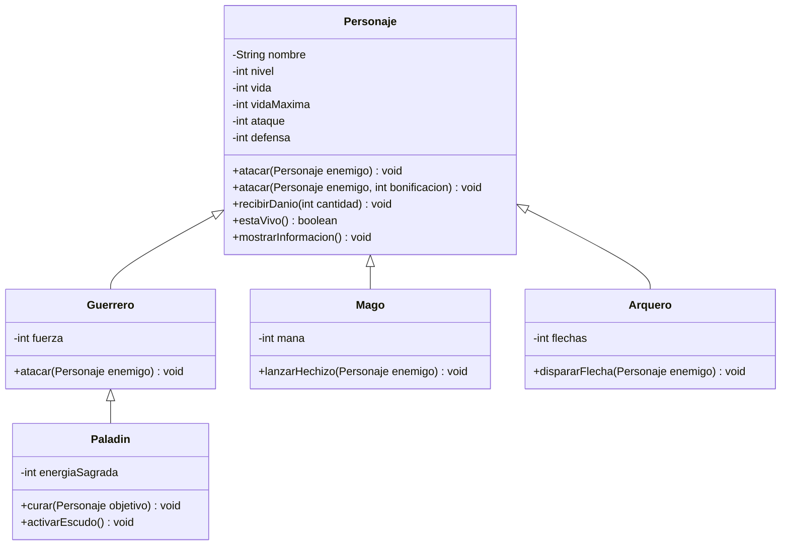

# 🎮 ESFOT RPG: La Batalla de los Reinos

> **Tarea integradora — Programación Orientada a Objetos (Java)**  
> **Modalidad:** individual · **Tiempo estimado:** 4–5 horas · **Calificación:** 20 puntos

## 📖 Planteamiento del problema

Un estudio de videojuegos necesita un prototipo de **juego de rol (RPG) por consola** que permita registrar personajes con distintas características, consultar sus datos y enfrentarlos en combates por turnos. Actualmente, el equipo mantiene información y comportamientos de cada personaje por separado, lo que provoca duplicación de código y dificulta incorporar nuevos tipos de héroes.

Tu misión es construir **ESFOT RPG: La Batalla de los Reinos**, una aplicación Java que resuelva este problema aplicando **herencia, encapsulamiento, constructores, `super`, sobrescritura, sobrecarga, polimorfismo y colecciones**.

El sistema no requiere interfaz gráfica ni base de datos. Toda la interacción será mediante consola y `Scanner`.

## 🎯 Objetivos de aprendizaje

- Modelar **herencia simple, jerárquica y multinivel**.
- Reutilizar atributos y métodos mediante `extends` y `super`.
- Diferenciar **sobrescritura (`@Override`)** de **sobrecarga**.
- Aplicar polimorfismo con referencias de tipo `Personaje`.
- Utilizar `List`/`ArrayList` y `Map`/`HashMap`.
- Emplear `instanceof` y casting seguro para acceder a habilidades específicas.
- Validar entradas y estados de los objetos.

> **Alcance:** No se deben utilizar interfaces, clases abstractas ni patrones de diseño. Estos temas aún no forman parte de la actividad.

## 🧬 Modelo de herencia requerido



**Tipos de herencia que deben identificarse en el proyecto:**

| Tipo | Ejemplo |
|---|---|
| Simple | `Guerrero extends Personaje` |
| Jerárquica | `Guerrero`, `Mago` y `Arquero` heredan de `Personaje` |
| Multinivel | `Paladin extends Guerrero extends Personaje` |

## ⚙️ Requisitos funcionales

### 1. Clase `Personaje`

Crear una clase **concreta** con los atributos privados `nombre`, `nivel`, `vida`, `vidaMaxima`, `ataque` y `defensa`.

Debe incluir:

- Constructor con parámetros, getters y setters con validaciones.
- `mostrarInformacion()`: imprime todos los datos generales.
- `estaVivo()`: retorna `true` si `vida > 0`.
- `recibirDanio(int cantidad)`: aplica el daño sin permitir vida negativa.
- `atacar(Personaje enemigo)`: ejecuta un ataque normal.
- `atacar(Personaje enemigo, int bonificacion)`: sobrecarga que añade una bonificación al ataque.

**Reglas mínimas de validación:** nombre no vacío; nivel y vida máxima positivos; ataque y defensa no negativos; vida entre `0` y `vidaMaxima`; bonificación no negativa. No se debe permitir atacar a un personaje derrotado.

Para evitar aplicar dos veces la defensa, el daño de un ataque se calculará **una sola vez** al recibirlo:

```java
int danioReal = Math.max(1, cantidad - defensa);
vida = Math.max(0, vida - danioReal);
```

El parámetro `cantidad` representa la potencia del ataque **antes** de descontar la defensa. Las habilidades que causen daño deberán utilizar esta misma regla.

### 2. Personajes especializados

| Clase | Atributo propio | Comportamiento requerido |
|---|---|---|
| `Guerrero` | `fuerza` | Sobrescribir `atacar(Personaje)` para sumar fuerza a la potencia del ataque. |
| `Mago` | `mana` | `lanzarHechizo(Personaje)`: consume 10 de maná y envía 20 puntos de potencia de ataque. |
| `Arquero` | `flechas` | `dispararFlecha(Personaje)`: consume una flecha y envía la potencia normal de ataque más 5. |
| `Paladin` | `energiaSagrada` | `curar(Personaje)`: consume 10 de energía y recupera hasta 20 de vida. `activarEscudo()`: protege del siguiente ataque. |

Para `Paladin`, el escudo debe reducir en **5 puntos** el daño de un solo ataque recibido, sin permitir daño negativo; después se desactiva. Se recomienda sobrescribir `recibirDanio(int cantidad)` y reutilizar `super.recibirDanio(...)` sin descontar la defensa dos veces. La curación nunca podrá superar `vidaMaxima` ni aplicarse a personajes derrotados.

Todas las clases hijas deberán tener constructores que invoquen `super(...)` y sobrescribir `mostrarInformacion()` para añadir sus atributos particulares, reutilizando `super.mostrarInformacion()`.

### 3. Colecciones y búsqueda

Mantener los personajes creados en:

```java
List<Personaje> personajes = new ArrayList<>();
Map<String, Personaje> registro = new HashMap<>();
```

- La lista permitirá recorrer y mostrar todos los personajes mediante polimorfismo.
- El mapa permitirá buscar personajes por nombre.
- No se aceptarán nombres duplicados; antes de registrar, comprobar `containsKey()`.
- Las dos colecciones deberán mantenerse sincronizadas cuando se agregue un personaje.

### 4. Menú interactivo

```text
====================================
       ESFOT RPG - JAVA POO
====================================
1. Crear Guerrero
2. Crear Mago
3. Crear Arquero
4. Crear Paladín
5. Mostrar personajes
6. Buscar personaje por nombre
7. Atacar a otro personaje
8. Utilizar habilidad especial
9. Simular combate por turnos
10. Mostrar personajes vivos
11. Salir
Seleccione una opción:
```

El programa debe repetir el menú hasta elegir **11**. Debe solicitar por teclado los datos necesarios y manejar entradas inválidas sin terminar inesperadamente.

### 5. Habilidades y casting

Al seleccionar una habilidad especial, identificar el tipo real del personaje mediante `instanceof` y realizar el casting solo cuando corresponda. Por ejemplo, un `Mago` puede lanzar hechizos, pero un `Arquero` no.

El sistema debe mostrar un mensaje cuando no existan recursos suficientes (maná, flechas o energía sagrada). No se deben consumir recursos si la acción no se ejecuta.

### 6. Combate por turnos

- Seleccionar dos personajes existentes y distintos.
- No permitir iniciar combates con personajes derrotados.
- El primero ataca y luego se alternan turnos.
- Mostrar atacante, objetivo, daño efectivo y vida restante.
- Terminar inmediatamente cuando uno llegue a 0 de vida.
- Anunciar el ganador.
- Los cambios de vida y recursos deben conservarse en los objetos registrados.

**Ejemplo ilustrativo:**

```text
===== COMBATE RPG =====
Thor (Guerrero) vs Merlin (Mago)
Turno 1: Thor ataca a Merlin
Vida de Merlin: 65
Turno 2: Merlin ataca a Thor
Vida de Thor: 88
...
GANADOR: Thor
```

Los valores concretos dependerán de los atributos de los personajes.

## 🗂️ Estructura sugerida

```text
ESFOT-RPG/
├── src/
│   ├── personajes/
│   │   ├── Personaje.java
│   │   ├── Guerrero.java
│   │   ├── Mago.java
│   │   ├── Arquero.java
│   │   └── Paladin.java
│   ├── juego/
│   │   └── GestorJuego.java
│   └── Main.java
├── README.md
└── diagrama_clases.png
```

`Main` debe controlar la interacción por consola y `GestorJuego` la administración de personajes y los combates. Se permite una organización equivalente si se justifica en el README.

## 🧪 Pruebas mínimas obligatorias

1. Crear un personaje de cada tipo y mostrar sus atributos.
2. Rechazar un nombre duplicado y una dimensión/estadística inválida.
3. Ejecutar un ataque normal y otro con bonificación.
4. Verificar que el daño respete la defensa y que la vida nunca sea negativa.
5. Lanzar un hechizo con maná suficiente e insuficiente.
6. Disparar hasta agotar las flechas.
7. Curar sin superar la vida máxima y comprobar el escudo del Paladín.
8. Mostrar personajes mediante `List<Personaje>`.
9. Buscar por nombre usando `HashMap`.
10. Completar un combate y comprobar que el ganador se anuncia correctamente.

## 🧠 Preguntas de análisis

Responder con palabras propias en el README de la solución:

1. ¿Dónde se aplica herencia simple en el proyecto?
2. ¿Por qué `Personaje → Guerrero → Paladin` representa herencia multinivel?
3. ¿Qué relación ejemplifica herencia jerárquica?
4. ¿Cuál es la diferencia entre sobrescritura y sobrecarga de `atacar()`?
5. ¿Qué aporta `super` en constructores y métodos?
6. ¿Por qué `List<Personaje>` admite guerreros, magos, arqueros y paladines?
7. ¿Qué versión de `mostrarInformacion()` se ejecuta al recorrer la lista y por qué?
8. ¿Cuándo se necesita `instanceof` antes de hacer casting?
9. ¿Qué ventaja aporta `HashMap` para localizar un personaje por nombre?
10. ¿Cómo se protege la consistencia de los atributos mediante encapsulamiento?

## 📦 Entregables

Entregar **un enlace al repositorio público de GitHub** que contenga:

1. Código Java completo, compilable y organizado en paquetes.
2. `README.md` de la solución con descripción, instrucciones de ejecución, explicación de la herencia y respuestas a las preguntas.
3. Diagrama UML de clases (`.png`, `.pdf` o Mermaid dentro del README).
4. Capturas de pantalla que demuestren creación, búsqueda, habilidades y un combate completo.

No incluir archivos compilados innecesarios ni credenciales. Cada estudiante debe poder explicar su código durante una revisión.

## 📊 Rúbrica (20 puntos)

| Criterio | Puntos |
|---|---:|
| Clase padre y encapsulamiento | 2 |
| Herencia simple, jerárquica y multinivel | 4 |
| Constructores y uso de `super` | 2 |
| Sobrescritura y sobrecarga | 3 |
| Polimorfismo y casting seguro | 3 |
| `ArrayList` y `HashMap` | 2 |
| Menú interactivo y combate | 2 |
| UML y documentación | 2 |
| **Total** | **20** |

## ⏱️ Plan sugerido de trabajo

| Etapa | Tiempo |
|---|---:|
| Diseño de clases y UML inicial | 30 min |
| Clase padre y herencia simple | 45 min |
| Herencia multinivel y sobrescritura | 40 min |
| Polimorfismo y colecciones | 35 min |
| Menú y combates | 65 min |
| Pruebas, UML final y documentación | 25 min |
| **Total** | **240 min (4 horas)** |

## 📚 Material de referencia de clase

- [Semana 6 — Programación Orientada a Objetos](https://github.com/jzaldumbide/semana6-POO)
- [Semana 6 — Figuras geométricas](https://github.com/jzaldumbide/seman6_figuras)

**Importante:** Los repositorios anteriores son material de apoyo. La solución del videojuego debe desarrollarse como un proyecto propio, no como una copia de las figuras geométricas.

---

**Criterio de éxito:** el videojuego funciona en consola, utiliza los tres tipos de herencia solicitados y demuestra polimorfismo real al trabajar con diferentes personajes a través de referencias `Personaje`.
# actividad_de_repaso_POO
